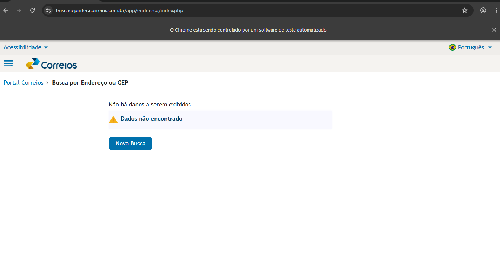
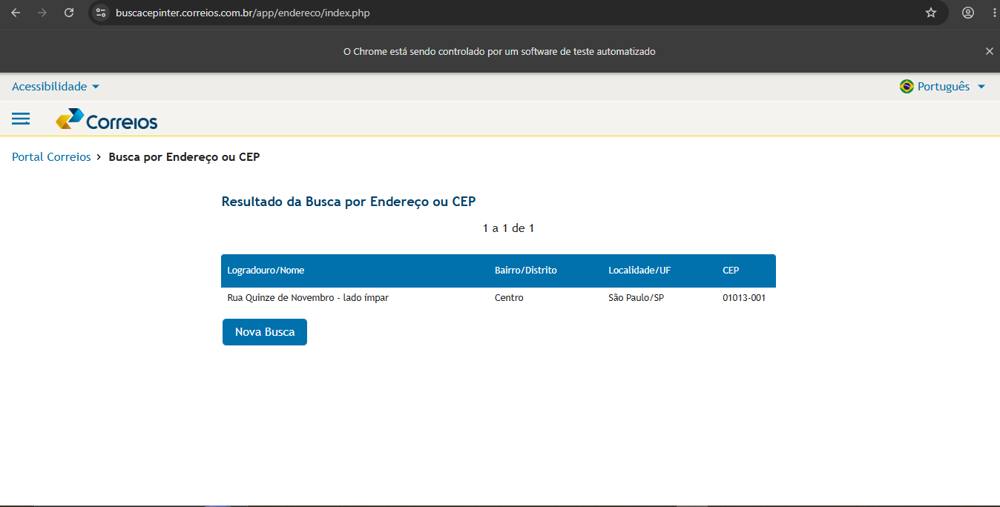
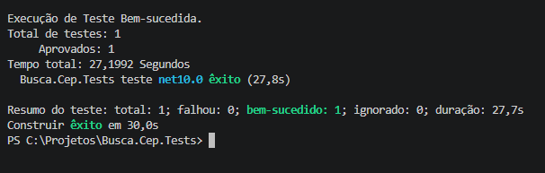
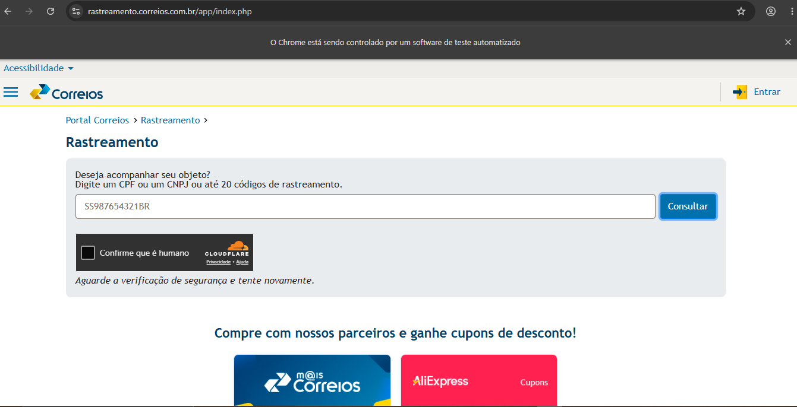

# Automação de Testes — Correios | Avaliação Técnica B3

Projeto desenvolvido para avaliação técnica de automação de testes, utilizando **C#, Selenium WebDriver, Reqnroll (BDD) e NUnit**.

## Objetivo

Automatizar os fluxos de consulta de CEP e rastreamento de objetos no site dos Correios, validando os resultados apresentados ao usuário.

O projeto foi estruturado utilizando boas práticas de automação, com separação de responsabilidades, reutilização de código e validações automatizadas.

## Tecnologias utilizadas

- **C# / .NET 10** — Linguagem e plataforma de desenvolvimento
- **Selenium WebDriver** — Automação das interações com o navegador
- **Reqnroll** — Desenvolvimento de cenários BDD com Gherkin
- **NUnit** — Execução e validação dos testes
- **Page Object Model (POM)** — Organização e reutilização de código
- **Allure Report** — Relatórios HTML com resultados, passos BDD e screenshots automáticos
- **Git / GitHub** — Versionamento e publicação do projeto
- **Visual Studio Code** — Ambiente de desenvolvimento

## Estrutura do projeto

```text
Busca.Cep.Tests/
├── Features/
│   ├── BuscaCep.feature
│   └── Rastreamento.feature
├── StepDefinitions/
│   ├── BuscaCepSteps.cs
│   └── RastreamentoSteps.cs
├── Pages/
│   ├── BuscaCepPage.cs
│   └── RastreamentoPage.cs
├── Drivers/
│   └── WebDriverFactory.cs
├── Hooks/
│   └── TestHooks.cs
├── Evidencias/
├── Busca.Cep.Tests.csproj
├── .gitignore
└── README.md
```

A estrutura utiliza o padrão **Page Object Model**, separando os cenários BDD, as interações com as páginas e o gerenciamento do navegador.

## Cenários implementados

### 1. Consulta de CEP inexistente

**CEP:** `80700000`

- Acessar a página dos Correios.
- Preencher o CEP.
- Realizar a consulta.
- Validar a mensagem "Dados não encontrado".
- Retornar à tela inicial.

**Resultado:** Aprovado com preenchimento manual do CAPTCHA.

### 2. Consulta de CEP existente

**CEP:** `01013-001`

- Realizar a consulta do CEP.
- Validar o logradouro "Rua Quinze de Novembro".
- Validar a localidade "São Paulo/SP".
- Retornar à tela inicial.

**Resultado:** Aprovado com preenchimento manual do CAPTCHA.

### 3. Rastreamento de objeto

**Código:** `SS987654321BR`

- Acessar a página de rastreamento dos Correios.
- Informar o código de rastreamento.
- Executar a consulta.
- Validar a mensagem de código não localizado.

**Resultado:** Validação automatizada não concluída devido à verificação de segurança do Cloudflare no ambiente público dos Correios.

## Estratégia de automação

O projeto utiliza o padrão **Page Object Model (POM)** para separar os elementos e as interações com as páginas dos cenários BDD.

### Seletores utilizados

Foram implementados os três tipos de seletores solicitados na avaliação:

| Tipo | Utilização |
|------|------------|
| ID | Identificação de campos e botões |
| XPath | Validação de mensagens retornadas |
| CSS Selector | Validação de logradouro e localidade |

### Boas práticas aplicadas

- Separação entre Features, Steps, Pages e Hooks.
- Reutilização de métodos e seletores.
- Esperas explícitas utilizando `WebDriverWait`.
- Validações com NUnit.
- Gerenciamento do navegador utilizando Hooks.
- Encerramento automático do navegador após os cenários.
- Tratamento da intervenção manual necessária para o CAPTCHA.

## Como executar

### Pré-requisitos

- .NET 10 SDK
- Google Chrome instalado
- Git
- Acesso à internet

### 1. Clonar o repositório

```bash
git clone https://github.com/marcosthecruz/correios-automation-tests
cd correios-automation-tests
```

### 2. Restaurar as dependências

```bash
dotnet restore
```

### 3. Compilar o projeto

```bash
dotnet build
```

### 4. Executar os testes de CEP

```powershell
dotnet test --filter "TestCategory=buscaCep" --logger "console;verbosity=normal" -- NUnit.ConsoleOut=0
```

O comando executa o cenário integrado das consultas de CEP.

**Importante:** durante a execução será necessário preencher manualmente os CAPTCHAs apresentados pelo site dos Correios.

## Interação manual com CAPTCHA

O site público dos Correios exige o preenchimento de CAPTCHA durante as consultas de CEP.

Para permitir a execução dos testes sem contornar essa proteção, foi implementada uma interação manual somente para essa etapa.

As demais ações são realizadas automaticamente pelo Selenium.

### Instruções durante a execução

**1. Aguarde o preenchimento automático do CEP.**

O Selenium abrirá o navegador e preencherá o campo de consulta.

**2. Preencha o CAPTCHA apresentado.**

- Digite o texto da imagem no campo correspondente.
- **Pressione TAB após terminar de digitar.**
- **Não clique no botão Buscar.**

**3. Aguarde a continuação automática.**

Após identificar o preenchimento do campo e a saída dele com TAB, o Selenium continuará o fluxo:

- Clicará automaticamente no botão **Buscar**.
- Aguardará o retorno da consulta.
- Validará o resultado utilizando NUnit.
- Retornará à página inicial para a próxima consulta.
- Encerrará o navegador ao finalizar o cenário.

> **Atenção:** o preenchimento manual do CAPTCHA será solicitado nas duas consultas de CEP. O tempo máximo de espera é de **120 segundos por preenchimento**.

### Orientações no navegador

O projeto apresenta uma mensagem diretamente no navegador, orientando o usuário sobre o preenchimento do CAPTCHA.

Isso facilita a execução, sem exigir o acompanhamento constante das mensagens do terminal.

### Limitação da automação

O preenchimento do CAPTCHA é a única intervenção manual prevista nos cenários de CEP.

Por depender dessa interação, a execução é considerada **semiautomatizada** e não está preparada para execução totalmente desassistida em CI/CD no ambiente público dos Correios.

## Resultados e evidências

O cenário integrado de consulta dos dois CEPs foi executado e aprovado localmente.

As evidências estão organizadas na pasta `Evidencias/`.

| Evidência | Descrição |
|-----------|-----------|
| 01-cep-inexistente.png | Validação do CEP 80700000 |
| 02-cep-valido.png | Validação do endereço Rua Quinze de Novembro |
| 03-teste-aprovado.png | Resultado da execução dos testes de CEP |
| 04-rastreamento-bloqueado.png | Verificação de segurança no rastreamento |

### Evidências da execução

**CEP inexistente — 80700000**



**CEP existente — 01013-001**



**Resultado da execução automatizada**



**Bloqueio na consulta de rastreamento**




## Relatórios de Testes — Allure Report

O projeto possui integração com o **Allure Report**, permitindo gerar relatórios HTML com informações detalhadas sobre a execução dos testes automatizados.

### Funcionalidades do relatório

- **Dashboard:** visão geral dos testes executados, aprovados e reprovados.
- **Cenários BDD:** exibição dos passos Gherkin executados pelo Reqnroll.
- **Screenshots automáticos:** evidências capturadas após as validações dos CEPs.
- **Evidências de falhas:** captura automática da tela quando um cenário apresenta erro.
- **Tempo de execução:** acompanhamento da duração dos cenários.
- **Detalhamento de erros:** informações que auxiliam na investigação de falhas.

### Pré-requisitos

Para gerar e visualizar os relatórios, é necessário ter:

- .NET 10 SDK
- Allure.Reqnroll configurado no projeto (restaurado automaticamente pelo NuGet)
- Allure Report CLI 2 instalado no computador
- Java compatível com a versão instalada do Allure CLI

O Allure CLI pode ser obtido no repositório oficial:

https://github.com/allure-framework/allure2/releases

> **Observação:** o Allure CLI é uma ferramenta externa ao projeto e deve ser instalado separadamente. O pacote Allure.Reqnroll já está configurado nas dependências do projeto.

### 1. Executar os testes e gerar os resultados

No terminal, dentro da pasta do projeto, execute:

```powershell
dotnet test --filter "TestCategory=buscaCep" --logger "console;verbosity=normal" -- NUnit.ConsoleOut=0
```

Durante a execução, preencha manualmente os CAPTCHAs apresentados pelos Correios e pressione **TAB** para que o Selenium continue.

Após finalizar, o Allure gerará os arquivos de resultados e as evidências em:

```text
bin/Debug/net10.0/allure-results/
```

### 2. Visualizar o relatório no navegador

Com o Allure CLI instalado, execute:

```powershell
allure serve ".\bin\Debug\net10.0\allure-results"
```

O comando gera um relatório temporário e abre uma visualização no navegador.

No relatório, é possível consultar os cenários executados, seus resultados, tempos de execução, passos BDD e screenshots anexados.

### 3. Gerar um relatório HTML permanente

Para salvar o relatório em uma pasta local, execute:

```powershell
allure generate ".\bin\Debug\net10.0\allure-results" -o ".\allure-report" --clean
```

O relatório será gerado na pasta:

```text
allure-report/
```

### 4. Abrir o relatório salvo

Para abrir posteriormente o relatório gerado:

```powershell
allure open ".\allure-report"
```

### 5. Executar o Allure sem configurar o PATH

Caso o comando `allure` não esteja disponível no terminal, é possível executá-lo diretamente pelo caminho de instalação.

**Exemplo utilizado no ambiente de desenvolvimento:**

```powershell
& "C:\Ferramentas\allure-2.46.2\bin\allure.bat" serve ".\bin\Debug\net10.0\allure-results"
```

> O caminho acima é apenas um exemplo. Deve ser ajustado conforme o local e a versão do Allure instalados no computador.

### Evidências disponíveis no Allure

O relatório permite visualizar os screenshots anexados automaticamente durante a execução:

| Evidência | Descrição |
|-----------|-----------|
| CEP 80700000 | Mensagem de CEP não encontrado |
| CEP 01013-001 | Logradouro e localidade retornados |
| Falha de cenário | Screenshot capturado antes do encerramento do navegador |

### Observações importantes

- Os screenshots são anexados automaticamente ao relatório Allure.
- Não é necessário capturar manualmente as evidências a cada execução.
- As pastas `allure-results/` e `allure-report/` contêm arquivos gerados automaticamente e não precisam ser versionadas no GitHub.
- Para obter um relatório somente da execução atual, remova os resultados anteriores antes de executar os testes.
- Como os cenários de CEP dependem de CAPTCHA manual, a geração dos relatórios ocorre após uma execução assistida.


## Limitações conhecidas

### CAPTCHA — Busca CEP

O site exige o preenchimento manual do CAPTCHA durante as consultas.

O Selenium realiza automaticamente as demais interações e validações.

As instruções estão disponíveis na seção **Interação manual com CAPTCHA**.

### Cloudflare — Rastreamento

Durante a execução do cenário de rastreamento, a página dos Correios apresentou uma verificação de segurança do Cloudflare.

Essa proteção impediu a conclusão automatizada da consulta, mesmo após uma tentativa de confirmação humana.

O cenário foi implementado e mantido no projeto, porém sua validação completa não foi concluída.

Essa limitação foi documentada para apresentar os resultados da avaliação de forma transparente.

### Execução em CI/CD

O projeto pode ser compilado e executado utilizando o .NET CLI.

Entretanto, os cenários que dependem de CAPTCHA ou de verificações de segurança não são adequados para execução totalmente desassistida no ambiente público dos Correios.

Em um projeto corporativo, a alternativa mais adequada seria utilizar um ambiente de homologação autorizado, com mecanismos próprios para testes automatizados.

## Versionamento

O projeto utiliza Git e GitHub para controle de versão e disponibilização do código-fonte.

O versionamento permite acompanhar as alterações realizadas e facilita a manutenção e evolução do framework.

Para projetos em equipe, recomenda-se utilizar branches de desenvolvimento e Pull Requests para revisão antes da integração das alterações.

---

**Desenvolvido como parte da avaliação técnica de automação de testes da B3.**
